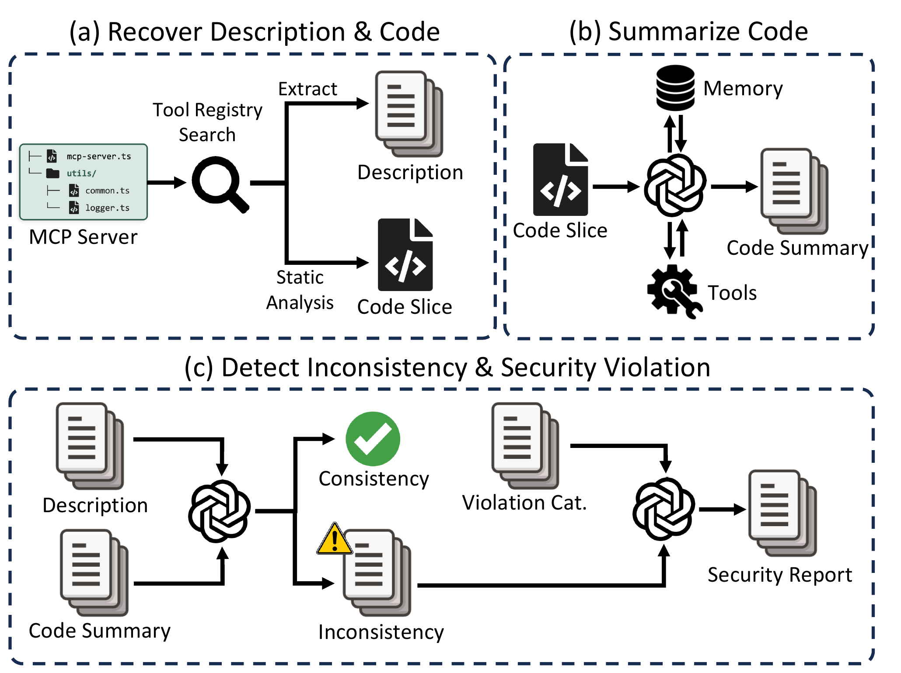

# ContractGuard: Auditing Semantic Contracts of MCP Tools for Security Violations

`ContractGuard` audits MCP tools by checking whether a tool's developer-provided description matches what its implementation actually does. It extracts a tool-specific code slice, summarizes it into a code-grounded description, compares the two descriptions, and classifies any inconsistency as instruction injection, misleading description, potentially malicious code, or unsafe implementation.



## Setup

```
python -m venv .venv
source .venv/bin/activate
pip install -r requirements.txt
cp .env.example .env    # then fill in your API key
```

Models are configured in [llm_config.json](llm_config.json). Each named entry is selected with `--llm <name>`:

```json
{
  "gpt-5.4": {
    "model": "gpt-5.4",
    "base_url": "https://api.openai.com/v1",
    "api_key_env": "OPENAI_API_KEY",
    "reasoning_effort": "medium"
  }
}
```

* `model`, `base_url`, `api_key_env` (required) - model name, endpoint, and the environment variable holding the API key
* `temperature`, `reasoning_effort` (optional) - passed to the model when set

## Usage

ContractGuard does not download MCP servers. Place each server's source tree in its own subdirectory:

```
servers/
├── server-a/
└── server-b/
```

Run the full pipeline:

```
python main.py --source servers/ --llm gpt-5.4 --all
```

`--all` runs the following stages in order; each one can also be run on its own:

| Option | Stage |
| --- | --- |
| `--extract` | Recover tool names, descriptions, arguments, and handler entry points |
| `--slice` | Build a reachable code slice for each tool |
| `--desc-gen` | Generate a code-grounded description from the slice |
| `--consistency-check` | Compare the developer description with the code-grounded one |
| `--judge` | Classify inconsistencies into threat classes |

Other options:

* `--result DIR` - output directory (default: `mcp_result/`)
* `--log DIR` - diagnostic log directory (default: `mcp_log/`)
* `--overwrite` - regenerate results that already exist
* `--single-tool SERVER/TOOL` - run slicing and LLM stages for one tool only

## Publication

```bib
ContractGuard: Auditing Semantic Contracts of MCP Tools for Security Violations

@inproceedings{ye:contractguard,
  title        = {{ContractGuard: Auditing Semantic Contracts of MCP Tools for Security Violations}},
  author       = {Hengkai Ye and Zhechang Zhang and Ruibo Lu and Jinyuan Jia and Hong Hu},
  booktitle    = {Proceedings of the 2026 ACM SIGSAC Conference on Computer and Communications Security (CCS 2026)},
  month        = {nov},
  year         = {2026},
  address      = {The Hague, Netherlands},
  doi          = {10.1145/3830454.3846789},
}
```

## Acknowledgment

We thank the National Science Foundation (NSF) and the Office of Naval Research (ONR) for supporting our work.
This research is supported in part by NSF under grants CNS-2450937, CNS-2555329, CNS-2339848, and CNS-2247652, and by ONR under grant N00014-26-1-2218.
